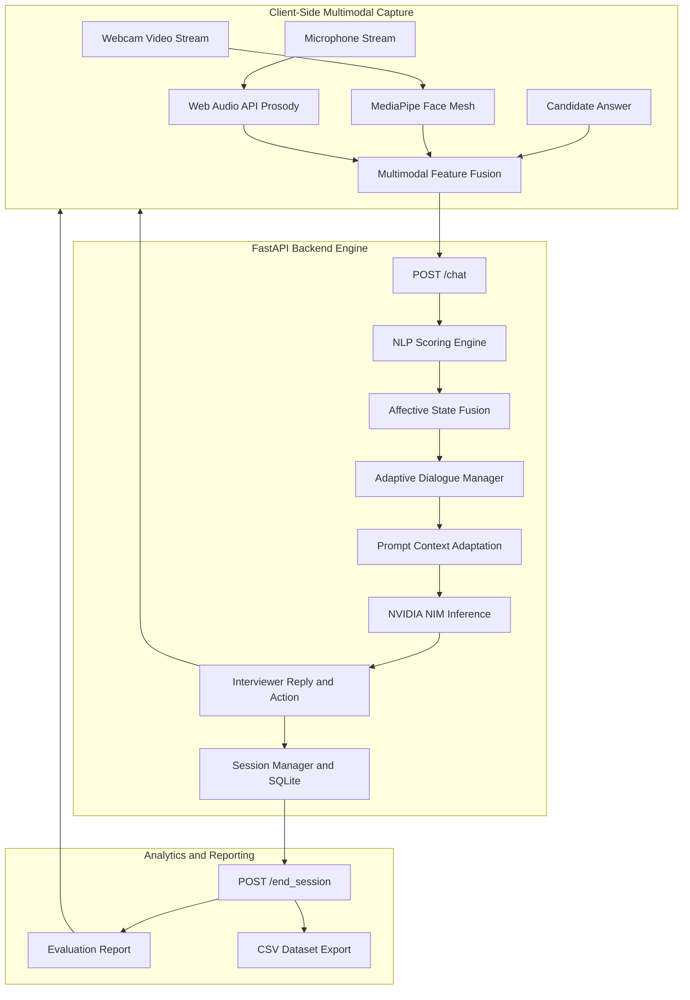

# Emotion-Aware Adaptive Human Interaction Simulator

[](https://fastapi.tiangolo.com)
[](https://reactjs.org/)
[](https://www.typescriptlang.org/)
[](https://vitejs.dev/)
[](https://tailwindcss.com/)
[](https://build.nvidia.com)
[](https://developers.google.com/mediapipe)
[](LICENSE)

A real-time, multimodal affective computing platform that estimates candidate emotional states (visual, vocal, and textual) to dynamically calibrate interview dialogue, question difficulty, and empathetic coaching strategies.

---

## Overview

The Emotion-Aware Adaptive Human Interaction Simulator combines client-side multimodal sensing with large language model dialogue management. By monitoring facial expressions, vocal prosody, answer structure, and technical keyword relevance, the system continuously estimates user confidence, stress, and engagement. It uses these state estimates to adapt interview questions in real time, keeping candidates challenged while preventing excessive stress.

---

## System Architecture



---

## Core Capabilities

- **Computer Vision Affective Tracking**: Real-time facial landmark estimation, head pose tracking, gaze focus estimation, and stress/confidence scoring using MediaPipe Face Mesh running entirely in the browser.
- **Web Audio Acoustic Analysis**: Non-invasive feature extraction measuring speaking rate (words per minute), pause/hesitation patterns, volume dynamics, and pitch stability.
- **Answer Quality and Technical Relevance**: Natural language analysis evaluating semantic completeness, keyword coverage, and lexical sentiment across targeted technical roles (Data Scientist, Software Engineer, Cloud Architect).
- **Adaptive Dialogue Manager**: A state-driven decision engine determining when to increase difficulty, simplify questions, provide encouragement, or request clarification.
- **NVIDIA NIM LLM Integration**: Low-latency question generation and dynamic prompt steering using hosted Llama 3.2 Vision Instruct models.
- **Controlled Experimentation Engine**: Dual-mode support for Baseline (control condition with fixed difficulty) versus Adaptive (experimental condition with dynamic adjustment), paired with automated session metrics and CSV export for research studies.

---

## Adaptive Decision Policy

The system balances candidate competency and affective state to maintain an optimal difficulty curve:

| Condition | Detected State | System Action | Dialogue Adjustment |
| :--- | :--- | :--- | :--- |
| High Quality and High Confidence | score >= 75, confidence >= 70 | ASK_HARDER | Increases technical complexity and depth. |
| Low Quality and High Stress | score <= 40, stress >= 65 | ASK_EASIER | Reduces difficulty to rebuild confidence and ease tension. |
| High Hesitation or Nervousness | hesitation >= 60 or long pauses | ENCOURAGE | Delivers supportive feedback before asking the next question. |
| Low Answer Completeness | completeness <= 35 | CLARIFY | Prompts the candidate to elaborate on vague points. |
| Low Domain Relevance | relevance <= 30 | CHANGE_TOPIC | Redirects discussion to core domain competencies. |
| Baseline Mode Active | Control Group | ASK_FOLLOW_UP | Standard sequential questioning with no difficulty shift. |

---

## Repository Structure

```text
emotion_adaptive_simulator/
├── app/
│   ├── backend/
│   │   ├── api/
│   │   │   └── chat.py             # FastAPI /chat and /end_session endpoints
│   │   └── main.py                 # Application entrypoint and CORS setup
│   └── frontend/                   # Streamlit alternative interface
│       ├── dashboard.py            # Streamlit experiment dashboard
│       └── streamlit_app.py        # Streamlit interactive chat
├── database/
│   ├── db_manager.py               # SQLite schema and session persistence
│   └── simulator.db                # Auto-generated SQLite database (gitignored)
├── frontend-react/                 # Primary Web Application (React + Vite + Tailwind)
│   ├── src/
│   │   ├── components/
│   │   │   ├── chat/               # Chat feed, message bubbles, input bar
│   │   │   ├── dashboard/          # Analytics charts and CSV export
│   │   │   ├── layout/             # Navigation sidebar, theme toggles
│   │   │   ├── ui/                 # Reusable interface components
│   │   │   └── vision/             # Face tracker and MediaPipe overlay
│   │   ├── context/
│   │   │   └── SessionContext.tsx  # Application state management
│   │   ├── services/
│   │   │   └── api.ts              # Backend API client
│   │   ├── App.tsx
│   │   └── main.tsx
│   ├── package.json
│   ├── tailwind.config.js
│   └── vite.config.ts
├── modules/
│   ├── dialogue/
│   │   ├── adaptive_manager.py     # Rule-based affective decision matrix
│   │   └── llm_interface.py        # NVIDIA NIM API integration
│   ├── nlp/
│   │   ├── answer_quality.py       # Completeness and structure scoring
│   │   ├── technical_relevance.py  # Keyword coverage analysis
│   │   └── text_emotion.py         # Sentiment and linguistic cue analysis
│   └── reporting/
│       └── report_generator.py     # Session diagnostic report generator
├── scenarios/
│   └── interview/
│       └── prompts.py              # Role-specific system prompts
├── utils/
│   └── session_manager.py          # In-memory rolling history and metadata
├── .env.example                    # Environment variable template
├── requirements.txt                # Python backend dependencies
└── README.md
```

---

## Installation and Setup

### Prerequisites
- Python 3.10 or higher
- Node.js 18 or higher with npm
- NVIDIA NIM API key (obtainable at [build.nvidia.com](https://build.nvidia.com))

---

### 1. Environment Configuration

Clone the repository:
```bash
git clone https://github.com/Soumya0204-star/emotion_adaptive_simulator.git
cd emotion_adaptive_simulator
```

Create a local environment file:
```bash
cp .env.example .env
```

Populate `.env` with your API credentials:
```ini
NVIDIA_API_KEY=your_nvidia_api_key_here
NVIDIA_MODEL=meta/llama-3.2-11b-vision-instruct
```

---

### 2. Backend Setup (FastAPI)

Install Python dependencies:
```bash
pip install -r requirements.txt
```

Start the backend server:
```bash
python -m uvicorn app.backend.main:app --reload --port 8000
```

- API Base URL: `http://127.0.0.1:8000`
- Swagger Documentation: `http://127.0.0.1:8000/docs`

---

### 3. Frontend Setup (React + Vite)

In a separate terminal:
```bash
cd frontend-react
npm install
npm run dev
```

Open `http://localhost:3000` in a browser with webcam and microphone permissions enabled.

*(Optional)* The repository also provides a Streamlit interface:
```bash
streamlit run app/frontend/streamlit_app.py --server.port 8501
```

---

## Research and Experimentation Protocol

The simulator provides built-in instrumentation for human-subject research:

1. **Participant Assignment**: Assign unique Participant IDs (e.g., P001, P002) and configure target domain roles.
2. **Independent Variable**: Select between Baseline Mode (unadapted control condition) and Adaptive Mode (multimodal real-time adjustment).
3. **Dependent Variables**: Measure answer quality, technical relevance, self-reported confidence, physiological stress indicators, and conversational turn counts.
4. **Data Export**: Export aggregated session records via the Analytics tab into `experiment_data.csv` for post-hoc statistical evaluation in Pandas, R, or SPSS.

---

## License

This project is licensed under the MIT License. See the `LICENSE` file for details.

---

## Author

Soumya  
GitHub: [@Soumya0204-star](https://github.com/Soumya0204-star)  
Vellore Institute of Technology (VIT)
